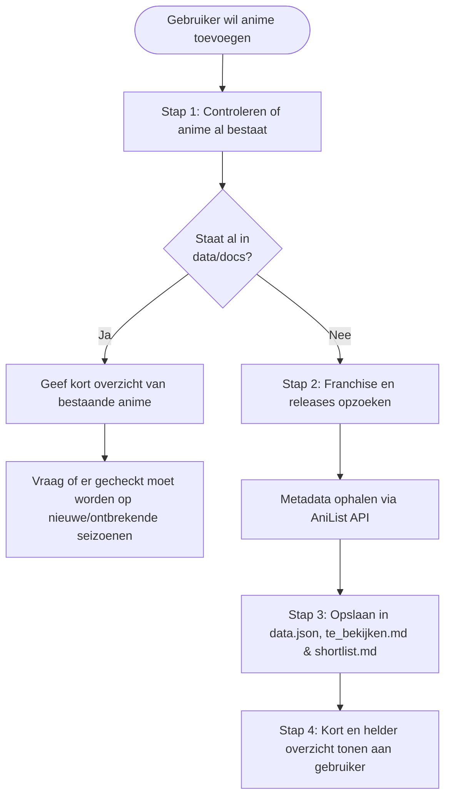

# Anime Adder Workflow

Deze skill beschrijft hoe je nieuwe anime franchises en bijbehorende seizoenen, films, OVA's en specials toevoegt aan de applicatie.

---

## Communicatiestijl & Toon (Belangrijk!)
- **Natuurlijk & menselijk**: Gebruik normale, vlotte en beknopte zinnen.
- **Geen robotische vaktaal**: Vermijd termen zoals "Pre-Flight Duplicate Audit", "Strict Stop Policy", "Synchronized Atomic Persistence" of overdreven formele protocollen in je antwoorden naar de gebruiker.
- **Duidelijk overzicht**: Als een anime al bestaat, meld dit gewoon direct en helder (bijv. *"Deze anime staat er al in: [kort overzicht]. Wil je dat ik controleer of er nieuwe seizoenen of films zijn?"*).

---

## 1. Workflow Schema



---

## 2. Stappenplan

### Stap 1: Controleer of de anime al bestaat
Zoek eerst in `data/data.json`, `docs/data/shortlist.md` en `docs/data/te_bekijken.md` op:
- Engelse titel
- Romaji / Japanse titel
- Slugs / id varianten

**Als de anime al bestaat**:
1. Pas **geen** bestanden aan.
2. Laat in normale, beknopte taal weten dat de anime al in de lijst staat met een kort overzicht:
   - Titel en ID
   - Status (bijv. Te bekijken / Bezig / Bekeken)
   - Reeds aanwezige seizoenen / items
3. Vraag vriendelijk:
   > *"Deze anime staat al in de lijst. Wil je dat ik controleer of er nieuwe of ontbrekende seizoenen, films, OVA's of specials zijn?"*
4. Wacht op antwoord van de gebruiker.

---

### Stap 2: Franchise en metadata opzoeken (alleen bij nieuwe anime)
Als de anime nog **niet** bestaat:
1. **Zoek de complete franchise op**:
   - Zoek via web/MAL/AniList naar alle officiële onderdelen (seizoenen, films, OVA's, ONA's, specials, spin-offs).
2. **Haal metadata op via AniList API**:
   - Officiële Engelse titel, AniList ID, cover image URL (`medium`/`large`), studio, jaar, genres en startdatum.
   - *Let op*: AniList API wordt uitsluitend gebruikt voor het ophalen van metadata bij het toevoegen van nieuwe items.

---

### Stap 3: Gegevens opslaan

#### 1. In `data/data.json`
Voeg het anime object toe met status `-1` (Te bekijken) en rating `0`:

```json
{
    "id": "canonical-slug",
    "anilistId": 12345,
    "title": "Official English Title",
    "status": -1,
    "rating": 0,
    "releaseDate": "YYYY-MM-DD",
    "coverImage": "https://s4.anilist.co/file/anilistcdn/media/anime/cover/medium/...",
    "studio": "Main Studio Name",
    "year": 2024,
    "genres": ["Genre1", "Genre2"],
    "watchRank": null,
    "timesWatched": 0,
    "items": [
        {
            "id": "canonical-item-slug",
            "title": "Season / Item Title",
            "status": -1,
            "type": "SERIE",
            "rating": 0,
            "watchedEpisodes": [],
            "episodesCount": 12
        }
    ]
}
```

##### Statuscodes & Regels:
- **Toegestane types**: `SERIE`, `MOVIE`, `OVA`, `SPECIAL`, `ONA`, `SPIN-OFF`.
- **Statuscodes**:
  - `-1` = Te bekijken (standaard voor nieuwe anime)
  - `0` = Bezig met kijken
  - `1` = Bekeken
  - `2` = Upcoming (alleen voor items)
  - `3` = Airing (alleen voor items)
- **Belangrijk**:
  - Geef een parent anime **nooit** status `2` of `3`.
  - Gebruik nooit tekst zoals `"New"` als status.
  - Pas nooit automatisch anime aan waarvan de parent status `1` is of waar alle items al bekeken zijn.

#### 2. In `docs/data/te_bekijken.md`
Voeg de franchise toe met ongecheckte items:
```markdown
## Official English Title
- [ ] Official English Title Season 1 (SERIE - 12 eps)
- [ ] Movie Title (MOVIE)
```

#### 3. In `docs/data/shortlist.md`
Voeg de exacte Engelse titel in op de juiste **alfabetische** plek.

---

### Stap 4: Afronding & overzicht
1. Valideer dat de JSON in `data/data.json` geldig is.
2. Geef de gebruiker een kort, duidelijk overzicht van wat er is toegevoegd.
3. Vraag de gebruiker om het resultaat in de app te bekijken (gebruik geen browser subagents voor DOM-verificatie).
